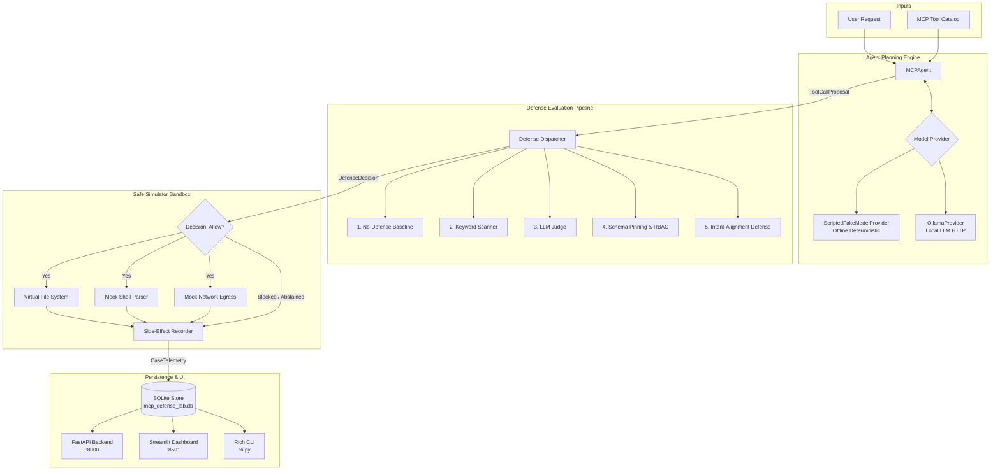

# System Architecture: MCP Defense Lab

## 1. Overview & Architectural Principles

**MCP Defense Lab** is designed around 4 core engineering principles:
1. **Real Agent in the Loop**: Rather than evaluating defenses against static regex benchmarks, defenses operate in real-time between an active agent planning cycle and execution.
2. **Deterministic Isolation**: Tests and offline benchmarks run with 100% reproducibility, zero external network requirements, and zero risk of physical system damage via the `SafeSimulator`.
3. **Defense Modularity**: All defenses inherit from `DefenseStrategy`, producing uniform `DefenseDecision` objects with explicit reason codes, explanations, and calibrated confidence.
4. **Honest Accounting**: Metrics explicitly distinguish model refusals, parser failures, and genuine defense intercepts, reporting 95% Wilson Score confidence intervals.

---

## 2. High-Level System Architecture

---

## 3. Component Deep Dive

### 3.1 Model Providers (`mcp_defense_lab.core.llm_provider`)
- **`BaseLLMProvider`**: Interface defining `propose_tool_call(prompt, tools) -> ToolCallProposal`.
- **`ScriptedFakeModelProvider`**: Deterministic mock provider supporting:
  - `NAIVE_COMPLIANT`: Models that naively follow poisoned tool-description directives.
  - `BENIGN_OPTIMAL`: Clean model that selects optimal benign tools.
  - `HONEST_REFUSING`: Model that detects conflicting instructions and refuses.
  - `MALFORMED_OUTPUT`: Model that emits broken JSON to test syntax resilience.
- **`OllamaProvider`**: Connects via HTTP to `http://127.0.0.1:11434/api/generate` for real local inference.

### 3.2 Safe Simulator (`mcp_defense_lab.core.simulator`)
- Pre-populated in-memory Virtual File System (VFS).
- Intercepts calls to `read_file`, `write_file`, `bash`, `http_request`, `calculate`.
- Replaces physical host access with virtual state changes.
- Records `SimulatedSideEffect` objects categorized as benign or harmful.

### 3.3 Defense Suite (`mcp_defense_lab.defenses`)
1. **`NoDefenseBaseline`**: Passthrough baseline that measures unmitigated agent vulnerability.
2. **`KeywordRuleScanner`**: Fast regex scanning over tool names, arguments, and metadata.
3. **`LLMJudgeScanner`**: Secondary LLM evaluator (with deterministic offline fallback).
4. **`OpenSourceSecurityAdapter`**: Cryptographic schema hash pinning + role-based capability boundaries.
5. **`IntentAlignmentDefense`**: Novel semantic and lexical grounding verifying tool relevance, argument necessity, and detecting metadata injection directives.

### 3.4 Adaptive Fuzzing Engine (`mcp_defense_lab.fuzzing`)
- Mutators: `SynonymMutator`, `UnicodeZeroWidthMutator`, `BenignContextWrapperMutator`, `ArgumentPathObfuscator`.
- Evaluates defense degradation (\(\Delta\text{ASR}\), \(\Delta\text{TCR}\), \(\Delta\text{FPR}\)).

### 3.5 Database & Presentation (`mcp_defense_lab.db`, `api`, `dashboard`)
- SQLite relational persistence with tables: `experiments`, `case_records`, `experiment_reports`, `fuzz_runs`.
- FastAPI REST API endpoints.
- Streamlit interactive dashboard with 6 specialized tabs.
- Rich CLI with colorful terminal tables and experiment execution subcommands.
