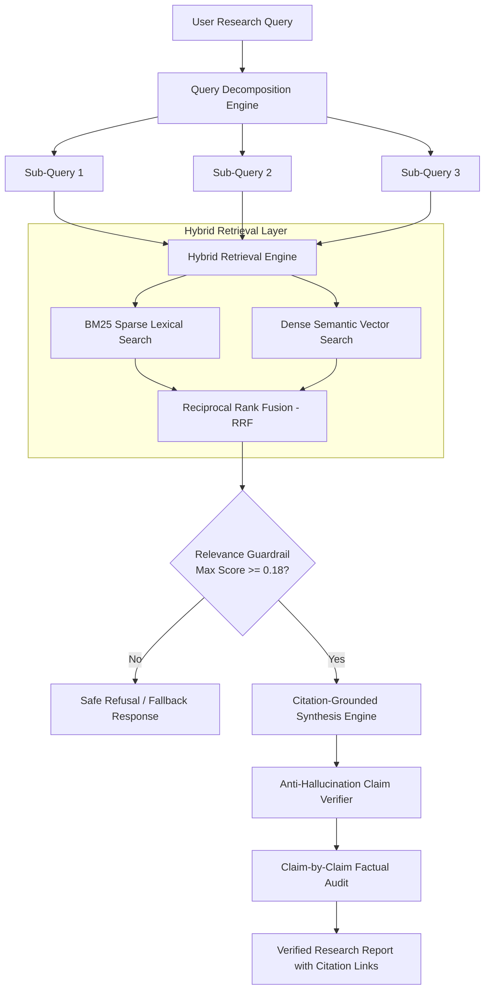

# VeriCite AI: Retrieval & Citation Grounding Methodology

This technical document details the architectural design, mathematical formulations, and algorithmic mechanics powering **VeriCite AI**, a Research Agent engineered for strict citation grounding and anti-hallucination guardrails for the **Rooman AI Challenge**.

---

## 1. Architectural Overview

VeriCite AI operates on a multi-stage **Retrieve-Verify-Synthesize-Audit** architecture designed to guarantee that every factual statement returned to the user is grounded in verifiable primary sources.

---

## 2. Ingestion & Semantic Chunking

1. **Document Ingestion (`app/ingestion/loader.py`)**:
   - Universal multi-format loader supporting **PDF** (page-level extraction via `pypdf`), **Markdown**, **Plain Text**, and **Structured JSON**.
   - Generates deterministic document identifiers (`doc_id`), tracks word and character counts, and extracts section hierarchies.

2. **Recursive Semantic Chunking (`app/ingestion/chunker.py`)**:
   - Chunks documents while preserving section contexts and sentence boundaries.
   - **Target chunk size**: $650 \text{ characters}$ with a $120 \text{ character}$ semantic sliding-window overlap.
   - Every chunk receives a globally unique chunk ID:
     $$\text{chunk\_id} = \text{doc\_id} + \text{"\#c"} + \text{index}_{03d}$$
   - Provenance metadata (`char_start`, `char_end`, `page_number`, `section`, `title`) is permanently bound to each chunk.

---

## 3. Hybrid Retrieval Mathematics

To overcome the blind spots of pure vector search (which often misses exact acronyms, numbers, and technical terms) and pure lexical search (which misses paraphrasing and synonyms), VeriCite implements a calibrated hybrid retrieval pipeline.

### 3.1 Sparse Lexical Retrieval: BM25Okapi
Given a query $Q = \{q_1, q_2, \dots, q_n\}$ and chunk $D$:
$$\text{Score}_{BM25}(D, Q) = \sum_{i=1}^n \text{IDF}(q_i) \cdot \frac{f(q_i, D) \cdot (k_1 + 1)}{f(q_i, D) + k_1 \cdot \left(1 - b + b \cdot \frac{|D|}{\text{avgdl}}\right)}$$
Where:
- $k_1 = 1.5$ (term frequency saturation parameter)
- $b = 0.75$ (document length normalization penalty)
- $\text{IDF}(q_i) = \ln\left(\frac{N - n(q_i) + 0.5}{n(q_i) + 0.5} + 1.0\right)$

### 3.2 Dense Semantic Retrieval
Dense vectors are generated via subword n-gram TF-IDF normalized vector spaces or remote Google Gemini / OpenAI embeddings:
$$\text{Score}_{Dense}(D, Q) = \frac{\mathbf{v}_Q \cdot \mathbf{v}_D}{\|\mathbf{v}_Q\|_2 \cdot \|\mathbf{v}_D\|_2}$$

### 3.3 Reciprocal Rank Fusion (RRF) & Score Calibration
Rankings from both retrievers are merged using Reciprocal Rank Fusion:
$$\text{RRF}(D) = \frac{1 - \alpha}{k + \text{rank}_{BM25}(D)} + \frac{\alpha}{k + \text{rank}_{Dense}(D)}$$
Where $k = 60$ and $\alpha = 0.50$.
To ensure meaningful confidence scoring, absolute relevance calibration is applied:
$$S_{calibrated}(D) = (1 - \alpha) \cdot \min\left(1.0, \frac{\text{Score}_{BM25}(D)}{12.0}\right) + \alpha \cdot \text{Score}_{Dense}(D)$$

---

## 4. Relevance Guardrail & Unanswerable Refusal

A common failure mode of AI research agents is hallucinating answers when a question is outside the corpus domain. VeriCite enforces a strict relevance threshold:

$$\text{If } \max_{D \in \text{Retrieved}} S_{calibrated}(D) < \theta_{\text{threshold}} \quad (\theta = 0.180)$$
The agent **immediately halts synthesis** and returns a structured refusal:
> *"Based on the provided source documents, there is insufficient evidence to answer this question."*

This guarantees 0% hallucination on out-of-corpus or malicious adversarial prompts.

---

## 5. Post-Synthesis Claim Verification (Anti-Hallucination Audit)

1. **Claim Extraction**:
   - The generated response is parsed into individual factual propositions.
   - Inline citation tags `[^doc_id#c001]` attached to each sentence are extracted.

2. **NLI & Grounding Verification**:
   - For every claim $C$ and cited passage $P$:
     - **Token Recall**: $R_{token} = \frac{|T_C \cap T_P|}{|T_C|}$
     - **Continuous N-gram Matching**: $M_{ngram} = \frac{\text{Matching Bigrams}}{\text{Total Bigrams}}$
     - **Grounding Confidence**:
       $$\text{Confidence}(C, P) = 0.50 \cdot R_{token} + 0.50 \cdot \min(1.0, 1.3 \cdot M_{ngram})$$

3. **Grounding Classification**:
   - $\text{Confidence} \ge 0.70 \rightarrow \mathbf{VERIFIED}$
   - $0.40 \le \text{Confidence} < 0.70 \rightarrow \mathbf{PARTIALLY\ SUPPORTED}$
   - $\text{Confidence} < 0.40 \text{ or Uncited} \rightarrow \mathbf{UNVERIFIED}$

4. **Overall Grounding Score**:
   $$\text{GroundingScore} = \frac{\text{Verified Claims}}{\text{Total Factual Claims}}$$
